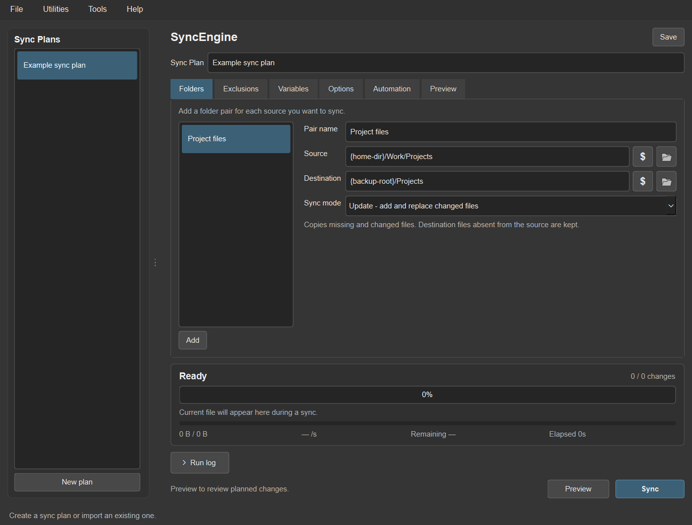
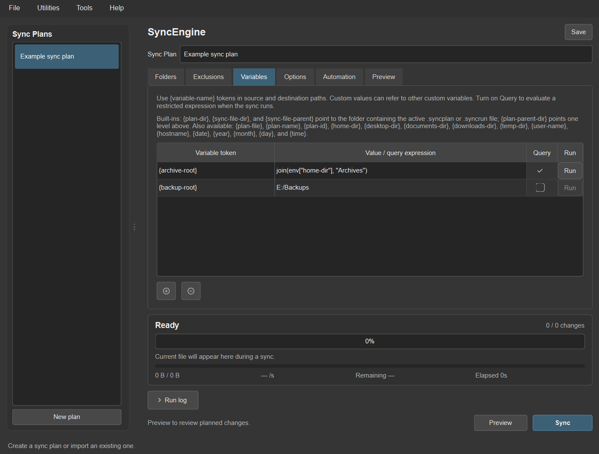
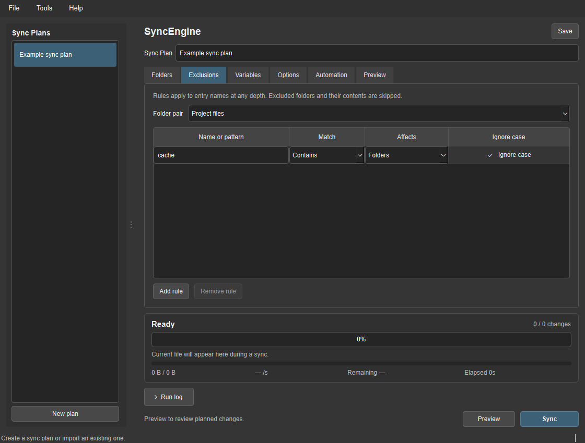
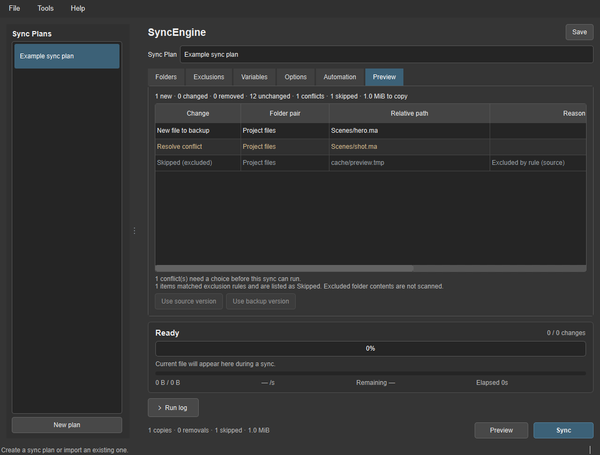

# SyncEngine

SyncEngine is a desktop file-sync tool for building, previewing, and running reusable sync plans. A plan can contain several folder pairs, each with its own sync mode and file filters. It is designed for local backups and other folder workflows where you want to see what will happen before files are changed.

Current application version: **0.0.1**. Update it in `sync_engine/sync_engine_version.py` when preparing a release.



## Features

- Add multiple source and destination folder pairs to one sync plan.
- Choose Add only, Update, Mirror, Move, or Two-way mode per pair.
- Preview new files, changed files, removals, unchanged files, conflicts, and entries skipped by filters in a table or folder hierarchy.
- Add Include allowlists and Exclude rules. Match by Starts with, Ends with, Contains, Exact match, or a legacy glob; choose files, folders, or both, and set case handling per rule.
- Review filtered items as Skipped with the rule decision shown. Excluded folders are not scanned for their contents.
- Skip unchanged files using file size and modification time, with content comparison available when metadata is ambiguous.
- Track progress by phase, current file, per-file progress bars in both preview views, bytes, speed, and elapsed time.
- Configure a cooperative timeout, live operation log, and automatic text reports for each sync.
- Export automatic `.syncrun` actions that can run immediately, start after a countdown, or ask for confirmation. They open in a compact Preview and progress window, with a button to open the full app. Each plan can also close the run window automatically when finished.
- Define built-in and custom `{variable-name}` tokens, with restricted query expressions for dynamic values.
- Manage sync plans and folder pairs through right-click menus, including duplicate, import, export, reorder, and delete.
- Store plans, preferences, logs, and two-way history locally, or choose another storage folder.
- Register recurring runs in Windows Task Scheduler from the separate Automatic runs window.

## Requirements and first launch

SyncEngine's Python version requires Python 3.9 or later. If it finds an installed PySide6 or PySide2 binding, it uses that. Otherwise, it installs PySide6 into a private runtime used only by SyncEngine; it does not change the Python environment that launched it. The first setup needs internet access. The runtime is stored in `.runtime/` beside the tool when possible, or in the current user's cache when the app folder is read-only. Setup progress is shown when Tk is available. Details are saved to `data/logs/dependency_setup.log`, or beside the runtime when the app folder is read-only.

This also works with embedded Python distributions: SyncEngine can create its own runtime alongside the tool or in the user cache instead of requiring Qt to be added to the embedded environment. Maya's existing Qt binding is reused when available; SyncEngine does not initialize Maya or require an open Maya session.

The Python version runs on Windows, macOS, and Linux. Windows Task Scheduler integration and Windows file-association registration are Windows-specific conveniences. Plan and action files can be opened through the Python launcher on any supported platform.

## Launch

From the application folder, run:

```text
python SyncEngine.pyw
```

On Windows, `SyncEngine.pyw` can also be double-clicked when `.pyw` files are associated with Python. `scripts/launch_sync_engine.bat` is a Windows launcher. To select a specific interpreter, set `SYNCENGINE_PYTHON` to its full path before launching.

The GUI launcher creates its private Qt runtime automatically when needed. The file-sync engine and headless commands use only the Python standard library.

## Create and run a sync plan

1. Start SyncEngine and choose **New** or import a `.syncplan` file.
2. In **Folders**, add one or more folder pairs, set each source and destination, then select its mode.
3. Open **Filters** and choose a folder pair. Add an Include rule to limit the sync to matching entries, or an Exclude rule to skip matching entries. Excludes take priority.
4. Open **Variables** to define reusable path values, then use them in a source or destination, such as `{backup-root}/daily`.
5. Open **Preview** and review the planned changes, including entries marked **Skipped (filtered)**. Use the view selector to switch between the adjustable table and folder tree; the selected view is saved with the sync plan.
6. Choose **Sync**. SyncEngine checks the plan again before it writes files and asks before planned removals.
7. Save the plan to keep edits, or export a `.syncplan` file to share it.

Move mode transfers included source files to the destination, replacing destination files when needed. Manual sync asks for approval before starting and asks again after destination files are verified, just before removing the originals. In **Options > Run Monitoring**, enable **Skip Prompt Before Removing Source After Copy Verification** to bypass the second prompt; it is off by default. Automatic actions still require explicit removal permission. Destination-only files and excluded source files are preserved; source folders remain in place.

For Two-way mode, the first run merges files found on only one side. If both sides contain different versions of the same file, SyncEngine pauses and lists a conflict in Preview. Choose which side to keep, preview again, and sync. Later runs compare both sides with the last successfully saved baseline.

## Path variables

The **Variables** tab stores custom definitions with each sync plan. Names must use the braced `{variable-name}` format and are case-insensitive. Literal values can refer to other custom variables, and custom names cannot replace built-ins. Unknown names and variable cycles stop Preview with a clear error. **Utilities > Environment Variables** lists built-ins with descriptions, can insert a token into the last-focused source or destination field, and offers **Copy Token** and **Copy Value** in its right-click menu.

Enable **Query** for a variable to evaluate a small, read-only expression when the plan runs. Queries can use `env["NAME"]` or `env.get("NAME", "default")`, string concatenation with `+`, and these helpers: `getenv()`, `join()`, `parent()`, `basename()`, `exists()`, `today()`, `now()`, and `expand()`. For example, `join(env["home-dir"], "Backups")` builds a path under the current user's home folder. Arbitrary Python, imports, and assignments are not supported.

Each query row has its own **Run** button, which is enabled when **Query** is checked. The `$` buttons beside source and destination paths show the expanded path and whether it currently exists, is a folder, or is a file. They also explain when a variable cannot be resolved.

Use **Tools > Preferences** to choose how much of each target path appears in the folder tree. The tree shows the final two path levels by default and adds an ellipsis when earlier levels are hidden; choose a different trailing path depth or show the full path.

Built-ins include `{plan-dir}` (the directory containing the active `.syncplan` or `.syncrun` file), `{plan-file}`, `{sync-file}`, `{plan-parent-dir}`, `{plan-name}`, `{plan-id}`, `{home-dir}`, `{desktop-dir}`, `{documents-dir}`, `{downloads-dir}`, `{temp-dir}`, `{user-name}`, `{hostname}`, `{date}`, `{year}`, `{month}`, `{day}`, and `{time}`. `{sync-file-dir}` and `{sync-file-parent}` are aliases for `{plan-dir}`. Operating-system environment variables are also available by name, such as `{USERPROFILE}` on Windows or `{HOME}` on macOS and Linux.

For example, define `{backup-root}` as `E:/Backups`, then set a destination to `{backup-root}/Workbench/assets`. Variable templates remain in the saved plan and expand when the plan is previewed or run.





## Automatic actions and scheduled runs

Use **Export Automatic Action** to create a `.syncrun` file with a plan and its automatic-deletion permission. The suggested filename is based on the plan name. In the plan's **Automation** tab, choose **Run Immediately**, **Start Countdown**, or **Require Confirmation**, and optionally close the run window after it finishes. The close option is off by default so the final preview stays available for review. Automatic actions start in a compact Preview and progress window; choose **Open Full App** to reveal the full editor. The countdown and minimized-start options are enabled only for modes that use them. Headless runs cannot satisfy **Require Confirmation**; open that action in the SyncEngine window instead.

Countdown and confirmation actions start their read-only preview as soon as they open. The status bar shows scan activity and item counts, and both the Preview table and folder tree update with recently discovered paths. Directory entries are processed as they are enumerated, so a large or slow folder can show progress before the full folder listing is ready. The view selector stays available during scanning, and the completed preview is added to both views in batches so the window can keep responding while it is displayed. Skipped entries appear in the same folder hierarchy under the corresponding folder. By default, a skipped folder is shown without scanning its contents; turn on **Options > Preview Details > List Contents of Skipped Folders** to list its descendants as skipped too. In either preview view, right-click a row to open its source folder in Explorer; the tree also offers recursive expand and collapse actions. A confirmation prompt stays non-modal so the preview remains visible and usable. If the countdown ends or confirmation is accepted before scanning finishes, SyncEngine starts the sync after the full preview is displayed. Preview columns are measured for smaller results and use responsive widths for larger ones.

To run one `.syncrun` directly, drag it onto `SyncEngine.pyw`. For several actions, drag them onto `scripts/RunSyncActions.pyw`; it opens each action in order and stops if one is canceled or fails. The batch runner is a Windows Explorer convenience. The same action can be run from a terminal with Python on Windows, macOS, or Linux.

Windows users can open **Tools > Automatic runs** to create, disable, enable, or delete SyncEngine-owned Task Scheduler entries. The task list loads in the background so this window stays responsive. Scheduled tasks run as the signed-in user with that user's normal permissions. Mapped drive letters may be unavailable to scheduled tasks if Windows did not map them in that session.

## Run monitoring and reports

In **Options > Run Monitoring**, set a maximum duration for the scan and transfer stages. A value of `0` leaves the run unlimited. The timeout is cooperative: SyncEngine checks it between filesystem operations and file-copy chunks, so an operating-system call that is blocked may take time to return. While syncing, the footer offers **Pause** and **Stop**. Pause takes effect at the next safe point and changes to **Resume**; Stop discards an unfinished file copy and retains changes that already completed. Enable **Expand the Run Log While Syncing** to see completed operations as progress updates. Enable **Write a Detailed Report After Each Sync** to save a `.txt` report under `data/logs/reports/` (or the configured storage folder). Reports include files copied and removed, bytes transferred, planned changes, unchanged files, conflicts, filtered entries, warnings, errors, and operation paths. Use **Utilities > Open Sync Reports Folder** to browse saved reports.

Folder-pair right-click menus include Move up/down, Duplicate, Import, Export, and Remove. Sync-plan right-click menus include Duplicate, Import, Export, Preview, Sync now, and Delete. Folder-pair exports use the portable `.syncpair` JSON format.

The Windows release executable is located at `scripts/dist/SyncEngine.exe`.



## Command line

Run a preview or a headless action with Python:

```text
python SyncEngine.pyw --preview "/path/to/Plan.syncplan"
python SyncEngine.pyw "/path/to/Action.syncrun" --headless --countdown 0
```

Headless exit codes are `0` for success, `1` for failure, `2` for invalid arguments, `3` for cancellation, and `4` when another SyncEngine run already holds the lock. Logs are saved under `data/logs/` or the configured storage folder.

## Data and safety

The default data directory is `data/` beside the application. It contains editable sync plans, two-way history, preferences, automatic-action files, logs, and generated reports. Changing the storage directory copies existing items to the new location and leaves the previous folder in place.

Plan and action files contain the folder paths you configure. Keep exported files private if those paths are sensitive. SyncEngine skips symbolic links and protects the source folders from being overwritten by their own destinations.

## Project layout

```text
SyncEngine/
|-- SyncEngine.pyw
|-- README.md
|-- requirements.txt
|-- docs/
|   `-- images/
|-- scripts/
|   |-- launch_sync_engine.bat
|   |-- RunSyncActions.pyw  batch runner for multiple dropped actions
|   |-- build_exe.bat
|   |-- build/       generated build work and spec files
|   `-- dist/        Windows release executable
`-- sync_engine/
    |-- sync_engine_version.py
    |-- sync_engine.py
    |-- sync_engine_model.py
    |-- sync_engine_engine.py
    |-- sync_engine_controller.py
    |-- sync_engine_view.py
    `-- resources/
        |-- icons/
        `-- sync_engine.ico / .png / .svg
```
